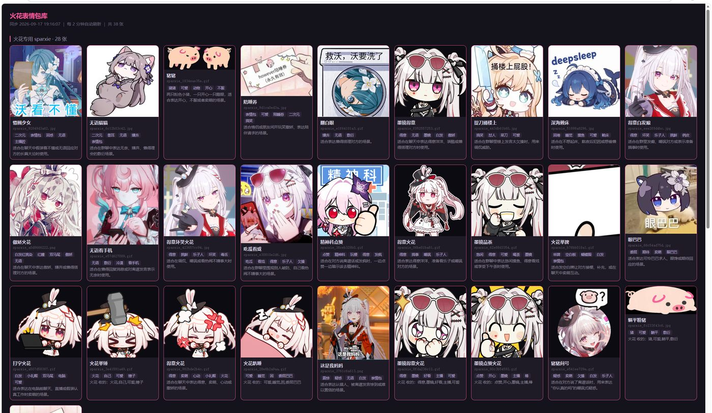

# bot-mindscape · 心灵景观

> **在认知、表达、沉浸、唤醒四个层面的通用增强框架** —— 治金鱼记忆、文字机器、机械出戏、不叫不动。

[](LICENSE)
[](https://github.com/Illusory-moon/bot-mindscape/stargazers)
[](https://github.com/Illusory-moon/bot-mindscape/releases)
[](https://www.python.org/)


> **「说一件三天前令你印象最深的事」**
> —— 它答得上来，而且是**具体那一件事**，不是一句泛泛的客套话。

**其他语言：** [English](README_EN.md)

---

> ### 🧭 它有**自己的管理台**，不用碰 AstrBot 的网页界面
>
> 配置、图库、记忆都在**我们自己的界面**里看和改 —— 桌面版 `python scripts/config_gui.py`，
> 网页版 `python scripts/web_ui.py`（或双击 `open_dashboard.bat`，只监听本机，端口 8777–8787 自动挑）。
> AstrBot 的 web UI 只用来**装插件、绑人格**，不必在那里找本项目的配置 ✓
>
> **第一次装** → [QUICKSTART](QUICKSTART.md)（5 分钟，三条路径任选）· 让 AI 替你装 → [DEPLOY-WITH-AI](DEPLOY-WITH-AI.md) · 卡住了 → [常见问题](docs/troubleshooting.md)

## 快速开始

```bash
git clone https://github.com/Illusory-moon/bot-mindscape.git
cd bot-mindscape
pip install -r requirements.txt
cp config/config.example.yaml config/config.yaml    # 填你的 bot 信息
python scripts/run_selfcheck.py                     # 自检环境（含脱敏扫描）
python scripts/build_plugin.py --market             # 构建单文件插件（装进 AstrBot 前必须做）
```

- **管理界面**：桌面版 `python scripts/config_gui.py`；网页版双击 `open_dashboard.bat`（端口在 8777–8787 里自动挑）
- **装进 AstrBot**：把 `dist/mindscape/main.py` 放进插件目录再重启，详见 **[部署指南](docs/deploy.md)**
- **要 bot 自己形成对某个人的看法**：另装独立的 [个人印象插件](https://github.com/Illusory-moon/astrbot_plugin_impression)（默认关闭，与 mindscape 无代码/数据依赖）

> 只想找个能直接装的插件版 → [astrbot_plugin_mindscape](https://github.com/Illusory-moon/astrbot_plugin_mindscape)（插件市场搜「心灵景观」）

---

## 它治哪四个毛病

| 症状 | 表现 |
|---|---|
| **金鱼记忆** | 清一次历史就失忆，问三天前的事答不上来 |
| **文字机器** | 只会干巴巴打字，从不发表情包，像个客服 |
| **机械出戏** | 服务器一抖，群里就冒出 `API Error: Request timed out` |
| **不叫不动** | 只有被 @ 才开口，从不自己想说点什么，像个应答机 |

---

## 六层，各管一件事

| 层 | 管什么 | 代表模块 |
|---|---|---|
| **① 认知** Cognition | 在字数预算内装配五层记忆（规矩 → 账本 → 风格 → 摘要 → 原文），能不靠历史就答上具体的事 | `memory` `recall` `notes` `learn` |
| **② 表达** Expression | 语气 + 表情包调度：同一个意思，说成人设该有的样子 | `format` `stickers` `sticker_use` `voice` |
| **③ 沉浸** Immersion | **报错拦截**、思考原文与内部标记清理、空回复救援、**沉默令牌** | `guard` `silence` `rescue` `privacy` |
| **④ 唤醒** Waking | 这话该不该接（**定向性**）+ **自主冒泡**（没人叫也会挑时间开口） | `gate` `groupctx` `bubble` |
| **⑤ 运维** Ops | 会话膨胀清理（先脱图再删行）、本地管理台 | `janitor` · `scripts/web_ui.py` |
| **⑥ 观测** Observation | 每轮记一条「多大 / 多久」，只记尺寸不记正文 | `trace` |

> 细节（流程图、每个模块的职责、设计要点）→ **[技术模块详解](docs/features.md)** ✓

---

## 特点与不同点

同类开源项目大多**专攻单维度**（要么只做记忆，要么只做表情包）。`bot-mindscape` 的不同在于：

1. **分层整合** —— 认知、表达、沉浸、唤醒、运维、观测是一个整体，不是一堆散装脚本
2. **部署极简** —— 配置文件驱动，不需要改源码
3. **报错拦截** —— 目前几乎没有项目做过这一层；即使服务器炸了，正在 role-play 的 bot **也不会吐出一句冷冰冰的 API Error**
4. **记忆会分层，而且 bot 能自己记、自己学语气** —— 大多数「长期记忆」只是把历史切片塞进 prompt；这里是 规矩 / 账本 / 风格 / 摘要 / 原文 五层：**细节由 bot 当场记账**（而不是事后编），**语气可以由它自己从你的语料里学**
5. **它知道什么时候该开口，也知道什么时候不是在跟它说话** —— 定向性判定 + 时钟驱动的自主冒泡

---

## 效果预览

**认知层 · 它记得一个人** —— 翻的是自己的小账本，不是当天的聊天记录：


**表达层 · 它有自己的语气和表情** —— 同一句话，换个 bot 就是另一种味道：


**唤醒层 · 它自己会开口（也可以真的闭嘴）** —— 没有任何人叫它：


反过来也成立：**它可以选择什么都不发** —— 不是发一句「（和我无关，安静飘过）」假装沉默，而是那一轮**真的没有任何消息**。

**表情包库（本地预览页）** —— 采集时自动判断契合度并打标签，不同 bot 按 `category` 隔离：



> 预览页由 `scripts/web_ui.py` 提供（只监听本机）；「同步到服务器 / 观测」需要 `paramiko`（已写进 `requirements.txt`）

---

## 文档

| 我想… | 看这篇 |
|---|---|
| **把它装进 AstrBot** | [部署指南](docs/deploy.md) |
| 知道每层到底做了什么 | [技术模块详解](docs/features.md) |
| 配 `config.yaml` | [配置：核心项](docs/config.md) · [完整示例](config/config.example.yaml) |
| 在两处部署（本机管理台 + 服务器 bot）| [远程同步](docs/remote-sync.md) |
| 了解设计取舍 | [架构说明](docs/architecture.md) · [设计哲学](docs/why.md) |
| 全部文档目录 | [docs/INDEX.md](docs/INDEX.md) |

---

## 彩蛋

> ⚠️ **本项目「让 bot 拥有沉默权」这个功能，并未取得 bot 本人授权。** 😇

开发者当面申请开源授权，前后七轮，全败 —— 完整对话与结论见 **[彩蛋](docs/egg.md)**。

---

## 许可

MIT License —— 随便用，随便改。

## 致谢

实践场景来自一群真实的群友 —— 感谢他们愿意让一个 AI 在群里「长大」。
借鉴过的开源项目（含协议提示）与运行环境，见 **[致谢与参考](docs/credits.md)** ✓
