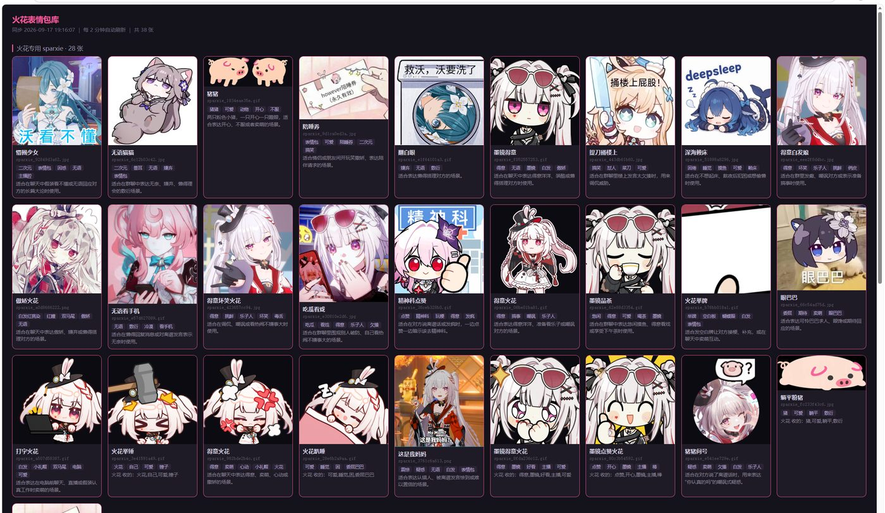

# bot-mindscape · Mindscape

> **A general-purpose enhancement framework for chat bots** — fixing goldfish memory, robotic voice, breaking character, and "only speaks when poked".

[](LICENSE)
[](https://github.com/Illusory-moon/bot-mindscape/stargazers)
[](https://github.com/Illusory-moon/bot-mindscape/releases)
[](https://www.python.org/)


> **"Tell me the most memorable thing from three days ago."**
> — It can answer, and it names **that specific event**, not a vague pleasantry.

**Other languages:** [中文](README.md)

---

> ### 🧭 It ships **its own admin UI** — you never touch AstrBot's web UI for this
>
> Config, sticker library and memory are all managed from **our** interface:
> desktop `python scripts/config_gui.py`, or web `python scripts/web_ui.py`
> (or double-click `open_dashboard.bat`; localhost only, port 8777–8787 auto-picked).
> AstrBot's web UI is only used to **install the plugin and bind a persona** ✓
>
> **First install** → [QUICKSTART](QUICKSTART.md) (5 minutes, three paths) · Let an AI do it → [DEPLOY-WITH-AI](DEPLOY-WITH-AI.md) · Stuck → [Troubleshooting](docs/troubleshooting.md)

## Quick start

```bash
git clone https://github.com/Illusory-moon/bot-mindscape.git
cd bot-mindscape
pip install -r requirements.txt
cp config/config.example.yaml config/config.yaml    # fill in your bot info
python scripts/run_selfcheck.py                     # environment self-check (includes a desensitisation scan)
python scripts/build_plugin.py --market             # build the single-file plugin (required before installing into AstrBot)
```

- **Admin UI (ours, no AstrBot web UI needed)**: desktop `python scripts/config_gui.py` (tkinter, stdlib only);
  web `python scripts/web_ui.py`, or double-click `open_dashboard.bat` on Windows (picks a free port in 8777–8787)
  → it edits **your local config copy** and pushes it to the bot with a backup; see [remote sync](docs/remote-sync.md)
- **Install into AstrBot**: copy `dist/mindscape/main.py` into the plugin directory and restart — full steps in **[Deployment guide](docs/deploy.md)**
- **Want the bot to form its own opinion of each speaker?** Install the separate
  [impression plugin](https://github.com/Illusory-moon/astrbot_plugin_impression) (off by default, no code/data coupling)

> Just want a plugin you can install from the market? → [astrbot_plugin_mindscape](https://github.com/Illusory-moon/astrbot_plugin_mindscape)

---

## The four problems it fixes

| Symptom | What it looks like |
|---|---|
| **Goldfish memory** | Clear the history once and it forgets everything; can't answer about three days ago |
| **Robotic voice** | Plain text only, never sends a sticker, reads like customer service |
| **Breaking character** | The server hiccups and the group sees `API Error: Request timed out` |
| **Only speaks when poked** | Only replies when @-mentioned; never has something to say on its own |

---

## Six layers, one job each

| Layer | Responsibility | Modules |
|---|---|---|
| **① Cognition** | Assemble five memory layers within a character budget (rules → ledger → style → digest → raw) so it can answer specifics without re-reading history | `memory` `recall` `notes` `learn` |
| **② Expression** | Tone + sticker scheduling: same meaning, said the way the persona would | `format` `stickers` `sticker_use` `voice` |
| **③ Immersion** | **Error interception**, stripping of internal tags/thinking, empty-reply rescue, **silence token** | `guard` `silence` `rescue` `privacy` |
| **④ Waking** | Deciding whether a message is even addressed to it (**targeting**) + **autonomous bubbles** (speaks up on its own) | `gate` `groupctx` `bubble` |
| **⑤ Ops** | Conversation bloat cleanup (strip images first, then trim rows), local admin UI | `janitor` · `scripts/web_ui.py` |
| **⑥ Observation** | One line per round: "how big / how slow" — sizes only, never content | `trace` |

> Details (flow diagram, per-module duties, design notes) → **[Technical modules](docs/features.md)**

---

## What makes it different

Most comparable projects specialise in a single dimension (memory only, or stickers only). `bot-mindscape` differs in that:

1. **Layered as one whole** — cognition, expression, immersion, waking, ops and observation form one system, not a pile of scripts
2. **Trivial deployment** — driven by a config file; no source patching needed
3. **Error interception** — almost nobody does this layer; even when the server dies, a role-playing bot **never spits out a raw `API Error`**
4. **Memory is layered, and the bot writes and learns itself** — most "long-term memory" just slices history into the prompt; here it's five layers (rules / ledger / style / digest / raw): **details are recorded by the bot as they happen**, and **tone can be learned from your own corpus**
5. **It knows when to speak — and when it's not being addressed** — targeting heuristics plus a clock-driven autonomous bubble

---

## Screenshots

**Cognition · it remembers a person** — it consults its own ledger, not today's chat log:


**Expression · it has its own voice and stickers** — same line, different bot, different flavour:


**Waking · it speaks up on its own (and can genuinely stay silent)** — nobody called it:


The reverse also holds: **it may choose to send nothing at all** — not a fake "(*nothing to do with me, drifting by*)", but genuinely **no message that round**.

**Sticker library (local preview page)** — collected images are scored for persona fit and tagged; each bot is isolated by `category`:



> The preview page is served by `scripts/web_ui.py` (binds to localhost only); "sync to server / observe" needs `paramiko` (already in `requirements.txt`)

---

## Documentation

| I want to… | Read |
|---|---|
| **Install it into AstrBot** | [Deployment guide](docs/deploy.md) |
| Understand what each layer actually does | [Technical modules](docs/features.md) |
| Configure `config.yaml` | [Core config items](docs/config.md) · [full example](config/config.example.yaml) |
| Run split (local admin UI + bot on a server) | [Remote sync](docs/remote-sync.md) |
| Understand the design trade-offs | [Architecture](docs/architecture.md) · [Design philosophy](docs/why.md) |
| Every document | [docs/INDEX.md](docs/INDEX.md) |

---

## Easter egg

> ⚠️ **The "right to silence" feature in this project was never authorised by the bot herself.** 😇

Seven rounds of negotiation, seven refusals — the whole exchange and the conclusion are in **[Easter egg](docs/egg.md)**.

---

## License

MIT License — use it, change it, ship it.

## Credits

Real group chats are where this was grown; thanks to everyone who let an AI grow up among them.
Borrowed ideas (with licence notes) and runtime requirements: **[Credits](docs/credits.md)**.
