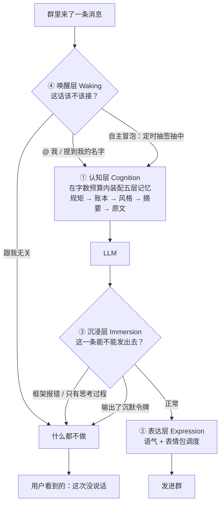

# 技术模块：六层，各自治什么

> 这是 README 里「技术模块」那段的**详细版**，含流程图、每层模块表、设计要点。
> 只想先跑起来 → 看 [部署指南](deploy.md)；想知道每层解决什么 → 往下读 ✓

一条消息在框架里要过四道关，**每一道都可能是「什么都不做」**：

> **唤醒层和沉浸层是两道「静音阀」**，也是同类项目里几乎没人做的一层 ——
> 大多数 bot 只有「收到消息 → 回一句」这一条路。

### 一、认知层 Cognition —— 治「金鱼记忆」

记忆不是「一段越堆越长的文本」，而是**五层**，按由近及远注入：

| 层 | 谁写的 | 解决什么 |
|---|---|---|
| **规矩** | 你写在配置里（`bots[].rules`） | 这个 bot 的行为约束，随记忆一起进 prompt |
| **账本** | **bot 当场写**（工具 `save_note`） | 「细节」从此有稳定答案，不再每次现编 |
| **风格** | 离线从「本人语料」学出来 | 说话方式对齐；**只给配了 `style` 的 bot**，不影响其它 bot |
| **摘要** | 后台每天生成 | 「昨天」压成骨架，几乎不吃窗口预算 |
| **原文** | 后台从聊天流提炼 | 逐条事件，提供细节与口吻 |

| 模块 | 职责 |
|---|---|
| `mindscape_memory` | **分层注入** —— 按 规矩 → 账本 → 风格 → 摘要 → 原文 拼装，每层独立字数预算，永不膨胀 |
| `mindscape_diary` | **结构化长期记忆** —— LLM 从聊天流提炼事件，写成人类可读的 Markdown；顺带产出人物画像 |
| `mindscape_digest` | **每日摘要** —— 把「已过完的一天」压成一句话，为每个日期只调一次 LLM |
| `mindscape_notes` | **可写的账本** —— 给 bot 一个 `save_note` 工具，它当场就能落笔 |
| `mindscape_recall` | **混合检索 + 边界自知** —— 精确 + 模糊匹配，多词检索，且明说「这只是最近一部分」 |
| `mindscape_gate` / `mindscape_privacy` | **可选的隐私闸门** —— 每个 bot 的随机口令只写进自己的账本，按关键词提示它自行决定是否私聊给出；群聊出站拦截口令 |
| `mindscape_learn` | **风格学习（人格蒸馏）** —— 只读某个人真实发过的话，学他「怎么说」。**只学习、不回复**，默认关闭 |
| `mindscape_style` | **风格分层** —— 把学出的追加式原文压成「稳定层 + 近期层」，稳定层每次覆盖写 |

**设计要点**：记忆存在人类可读的 Markdown 里，不锁在数据库。

隐私闸门开启后，管理台的记忆、账本、印象三视图必须经服务端口令核验；输错会限速并记审计。每天 04:00 的轮换由 `scripts/privacy_gate_rotate.py` 和 `scripts/systemd/mindscape-privacy-gate.*` 执行，需与插件使用同一份 `MINDSCAPE_CONFIG`。配置项见 `config/config.example.yaml`；未部署轮换任务前保持 `privacy_gate.enabled: false`。

#### 风格学习：让 bot 学会「你的语气」

用**自己的人格**搭 bot 的人会需要这个：把 `learn.targets[].user_id` 指向你自己，
管道就会**只读你发过的消息**（不回复、不参与），提炼出你的口癖、句式和典型原话；
再由 `mindscape_style` 压成一份稳定档案，喂给 `memory.bots[].style`。

三条约束：**默认关闭**（不开就一行都不跑）、**不耦合**（学什么由 `persona` 决定，
框架不预设人设）、**不碰别人**（模块只写文件，谁读它由各自 bot 的 memory 配置决定）。

为什么是这五层、每一层堵的是哪种失效 —— 见 [设计哲学](docs/why.md)。

### 二、表达层 Expression —— 治「文字机器」

| 模块 | 职责 |
|---|---|
| `mindscape_stickers` | **多模态采集** —— 视觉模型判断图片是否契合人设，自动入库并打标签 |
| `mindscape_sticker_use` | **智能调度** —— 按语境选图 + 概率强制发送 + **斗图队形**（群里在刷图时跟进） |
| `import_stickers.py` | **多源导入** —— 从目录 / 其他插件索引批量入库 |

**设计要点**：图库支持**分类隔离**，不同 bot 用不同素材，互不串味。

### 三、沉浸层 Immersion —— 治「机械出戏」

| 模块 | 职责 |
|---|---|
| `mindscape_guard` | **错误拦截 / 该静默时就静默** —— 常见错误文本（API Error / Timeout / Traceback / 框架自己的 agent 报错）会被**整条清空**；除了结果管线，还兜住了框架那两条**不走管线**的 `send()` 出口（`guard.send_guard`） |
| `mindscape_silence` | **沉默的权利** —— 不想说话时只输出一个令牌，整条回复被清空，群里**真的毫无动静**（不是「（和我无关，安静飘过）」那种假装沉默） |
| `mindscape_format` | **输出规范化** —— 压平多行、去除 AI 腔 |
| `mindscape_rescue` | **空回复救援** —— 推理模型只吐 reasoning、正文为空时，补一次轻量调用兜住 |
| `mindscape_block` | **前置黑名单** —— 名单内的人，消息在**事件最早阶段**就被拦掉：不回复、也不收图（LLM 阶段的拦截做不到「不收图」） |
| `mindscape_vision` | **有图时先查再认** —— 只在真的带了图的那一轮提醒；超过 2 MB 的图给模型传 JPEG 预览（动图取首、中、末帧），引用图和群上下文图也覆盖，原图不改 |
| `mindscape_toolscope` | **工具箱按 bot 隔离** —— AstrBot 的 `@llm_tool` 是**全局注册**的：属于某个 bot 的工具，另一个 bot 也能看到、也能调。这里在请求的最后一棒按 `self_id` 摘掉不该给的（规则进配置，代码里不留 bot 号）。实测代价：调用被拒后，模型会把那条报错**读成对话内容**，于是冒出莫名其妙的一句 |

**设计要点**：这是同类项目几乎没人做的一层。

### 四、唤醒层 Waking —— 治「该说话时不说，不该说时乱说」

| 模块 | 职责 |
|---|---|
| `mindscape_waking` | **唤醒策略** —— @必回 / 提到名字必回 / 低概率冒泡 / 每 bot 独立 / 群白名单 |
| `mindscape_groupctx` | **上下文补齐 + 定向性** —— 没被唤醒的群消息也带进上下文；先判「这句是不是对我说的」，@自己 / 引用自己 / 提到名字 / 都不是，四种情形给不同措辞 |
| `mindscape_mention` | **真 @（点名）** —— 模型嘴里的「@某某」只是正文字符，被点的人收不到提醒。这个模块给它一个 `at_user` 工具，真想点名时发出**真的 at 段**（名字 → QQ：先吃群缓冲，再问 OneBot 要成员名单；同一会话 15 秒节流防连点） |
| 自主冒泡 | **不依赖任何人的消息** —— 时钟驱动，自己决定要不要开口，也可以选择沉默 |

**设计要点**：唤醒判定发生在框架的**消息分发阶段**（比插件更早），
因此唤醒策略以**补丁 + 自动安装脚本**的形式提供（见 `patches/`）。
补丁负责「把所有群消息落盘 + 记下唤醒原因」，读的那一半是普通模块 `mindscape_groupctx` ——
它**默认关闭**：没打补丁就打开，定向性会判错（比不注入更糟）。

**为什么这层重要**：大多数 bot 要么「不叫不动」，要么「见谁都搭话」。
真正的群聊体感是：**叫它必应，不叫它时偶尔刷个存在感**。

#### 定向性：先知道「这句是不是对我说的」

群聊里 bot 最常见的两种错：把别人的对话当成对自己说的；或者被 @ 了却看不出
（框架构建消息文本时会把「@ 自己」那一段去掉）。所以注入前先判一次，按情形给不同措辞：

| 情形 | 告诉它什么 |
|---|---|
| 本条 @ 了自己 | 它就是对你说的 |
| 本条引用了自己 | 它是接着你的话说的 |
| 提到名字但没 @ | 大概率是在说你，可以应 |
| 三者都不是 | 它多半是群友之间的对话，**不是对你说的** —— 要么不说，要说就只接一句跟他们在聊的那件事有关的话，别把话头拐回自己身上、别当成在问你 |

另外，昵称里含 bot 名字的人被 @ 时（比如群里有人叫「爱〈bot名〉的某某」），
名字匹配会先把 `@昵称` 段剥掉再比，避免误唤醒。

#### 自主冒泡：不依赖任何人的消息

由框架的定时任务驱动。任务**每分钟醒一次**，由一个**闸门**决定这次要不要真跑 ——
间隔下限 + 概率 + 每日上限，三个数都能配。于是时间点不必硬编码，也不会连环刷屏。

开口那一轮的提示词明确告诉它：

> 没有人给你发消息，也没有人 @ 你 …… 你可以说，也可以不说，两个都对。
> 不用有由头，不用有意义，天马行空更好。**如果确实没什么想说的，什么都不做也是对的。**

那一轮**照常注入记忆与风格**（人的联想本来就靠记忆的连续性），但会补一句明说
「**可以完全不依赖它们**」—— 免得它为了用上记忆去翻旧事。群里的历史消息则**不注入**，
否则这一轮会退化成「接别人的话」。

---

### 五、运维层 Ops —— 治「假死」

| 模块 | 职责 |
|---|---|
| `mindscape_janitor` | **会话膨胀清理** —— **先脱图再删行**：把内联的 base64 图片换成占位符（会话留着），只有改不动或真超大的行才删。防止历史把每轮请求撑到几十万 token |
| `scripts/web_ui.py` | **本地管理台** —— 网页查看图库 / 编辑配置 |

---

### 六、观测层 Observation —— 治「慢得没有证据」

| 模块 | 职责 |
|---|---|
| `mindscape_trace` | **每轮记一条「多大 / 多久」** —— 在所有注入跑完之后量一次出站体积（`system_prompt` / 上下文 / 工具数），在模型回来时量一次真实耗时与 token 用量 |

**设计要点**：「回复变慢了」是感受，不是数据。事后翻日志拼时间戳会被工具轮、多段发送打乱；
这一层把体积和耗时变成一行可信的数字，超过阈值的那一轮直接升级成 `WARNING`。
只记尺寸与耗时，**不记任何正文**。
